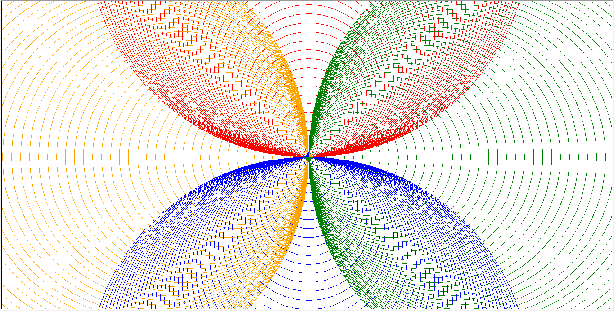
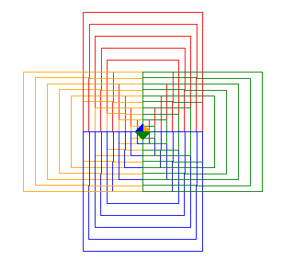
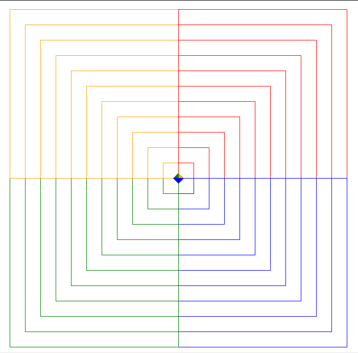
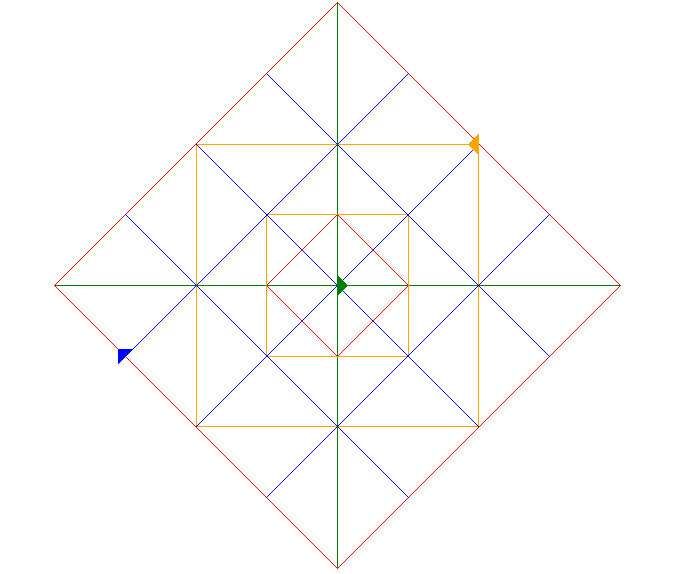

# Four Turtles

## Source Code: Four Turtles module

[View source code](../four_turtles.py)

## Overview

This module contains the class `TurtleFour` which contains premade drawing functions
which need a list of 4 turtles.

## Classes

### TurtleFour

Contains all drawings which require four turtles, all functions are accessible directly through [class Designs](designs.md#designs).

### Functions

#### flower_4petals

This function draws a four-petaled flower consisting of 500 circles.

##### Preview: flower_4petals

[flower_4petals showcase](./images/flower_4petals_showcase.png)

##### Source code: flower_4petals

[Click here to inspect the source code of TurtleFour.flower_4petals()](../four_turtles.py)

Comment Linking: [[#TurtleFour-flower-4petals-anchor|TurtleFour.flower_4petals()]] 

#### square4

This function draws four differently coloured squares, aligned with the four coordinate axes.

##### Preview: square4

[square4 showcase](./images/square4_showcase.png)

##### Source code: square4

[Click here to inspect the source code of TurtleFour.square4()](../four_turtles.py)

Comment Linking: [[#TurtleFour-square4-anchor|TurtleFour.square4()]] 

#### quadrant_square

This function draws 4 colors of squares in each quadrant.

##### Preview: quadrant_square

[quadrant_square showcase](./images/quadrant_square_showcase.png)

##### Source code: quadrant_square

[TurtleFour.quadrant_square()](../four_turtles.py)

Comment Linking: [[#TurtleFour-quadrant-square-anchor|TurtleFour.quadrant_square()]] 

#### multi_square_grid

This function draws a symmetrical checkerboard pattern with 4 turtles.

##### Preview: multi_square_grid

[multi_square_grid showcase](./images/multi_square_grid_showcase.png)

##### Source code: multi_square_grid

[TurtleFour.multi_square_grid()](../four_turtles.py)

Comment Linking: [[#TurtleFour-multi-square-grid-anchor|TurtleFour.multi_square_grid()]] 

#### Source code: TurtleFour

[class TurtleFour](../four_turtles.py)

Comment Linking: [[#TurtleFour-anchor|class TurtleFour]] 

## Source Code: Four Turtles module

[View source code](../four_turtles.py)
